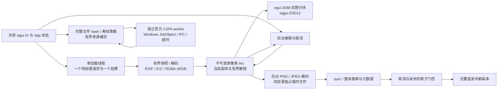

# 0.2.0 已实现架构与接口

这是共享图像处理与界面的实现结构说明。Windows 已运行 D3D12，Mac Metal 为后续验证路线。

| 接口 | 输入与输出 | 正确性责任 |
| --- | --- | --- |
| pipeline::load | Path、Cancellation → LoadedImage | 64 MiB/16 MP/边长与解码限额，EXIF/ICC/alpha、完整源 hash；像素由 Arc 持有 |
| Loader::request / take_result | generation、路径、取消令牌 → 可取结果 | 只保留一个待处理请求和一个结果，旧代不能替换 UI；枚举取消不得部分成功 |
| edit::apply | 原像素、EditOp、令牌 → 已拥有的新 Pixels | 不修改原图，透明缩放、裁剪/旋转/翻转、准入与取消边界 |
| export::save_new | 像素、原路径、Options、令牌 → 实际发布路径 | 临时文件、sRGB ICC、重读、无覆盖；取消先取得门控禁止发布，提交先取得门控报告真实结果 |
| provenance::inspect | 路径、打开时 hash、令牌 → EvidenceReport | 重新读取有界快照并核对 hash，再交给 worker；防止文件变更复用旧证据 |
| EvidenceCache | 文件全 hash、策略版本、信任快照 → 报告 | 合计序列化容量有界，取消/失败不缓存为完成；无可信根不显示可信发布者结论 |

UI 只在加载/编辑成功结果未取消且代次相符时应用像素。来源和预览也检查对应令牌。已发布导出成功保留真实成功状态。取消位与一次性发布权共享原子值，后到取消不会反转已取得的提交权，其他处理步骤仍能观察取消标记。

Snapshot 与 Pixels 将逻辑内存保留至真正释放；撤销最多3项且引用像素合计最多256 MiB。主程序逻辑准入768 MiB、worker进程限制512 MiB；这些分别是估算准入和 Windows JobObject 资源约束，不能合称硬沙箱或总RSS上限。egui现成纹理负责绘制，不使用自定义图像 shader；任务完成唤醒、输入与一次性计时触发重绘，禁止空闲无条件60fps。

平台层保留系统文件对话框、字体查找、GPU backend 和 worker资源限制。Mac复用UI、图像编辑/导出与协议，但字体、Metal实际运行和资源约束需要独立验证。GPU错误边界提供失败退出和重启路径，尚无自动Device重建。核心验收与未验证项以 releases/v0.4.0.md 和最新验证报告为准。
