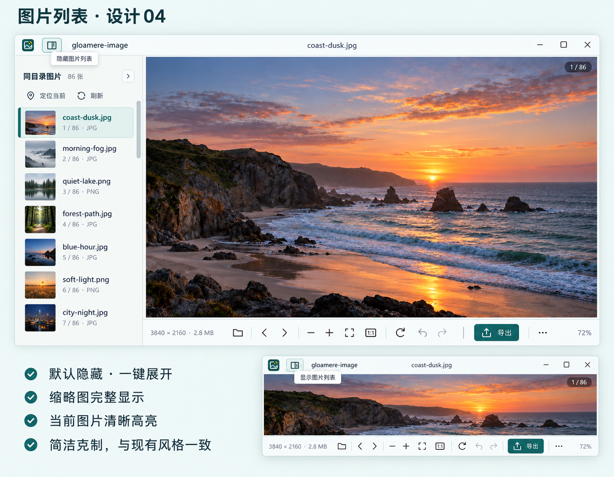

# 图片列表与显示开关 04

2026-10-20。使用内置 imagegen 生成的列表栏设计参考。



## 实施约定

- 现有浅色外框配森林绿强调色；列表默认宽 240 点，可拖动调整至 200–300 点。
- 左上角 logo 旁增加常驻分栏按钮，点击显示或隐藏列表；展开时显示选中态。列表标题旁也可关闭。
- 每次正常启动均先隐藏列表，包括旧配置保存了展开状态的情况；保留背景等其他偏好，不在启动时改写旧设置。
- 条目显示完整缩略图、文件名、序号与格式，当前图片使用浅绿底、绿色竖线和细描边。文件名过长时省略，悬停显示完整信息。
- 实施时保留已有的搜索、定位、刷新、排序、格式和 AI 状态筛选：搜索常驻，排序和筛选收进同一个弹出菜单。AI 检测仍仅从更多菜单手动发起。
- 继续使用可见行虚拟化和原缩略图缓存；隐藏时取消缩略图任务。
- 保留窄窗口自动收起、键盘焦点、弹窗隔离、文件名双击重命名与独立贴图的既有行为。

## 生成记录

工具：内置 imagegen。参考图：`ui-shell-buttons-03.png`。生成原件保留，选定输出复制为本目录的 `image-list-04.png`。

生成提示词：

```text
Use case: ui-mockup.
Asset type: high fidelity desktop image viewer UI redesign concept, Chinese annotations.
Primary request: redesign ONLY the left image list sidebar and add a small persistent show/hide sidebar button for the existing gloamere-image desktop photo viewer. Use the attached prior outer-frame design strictly as a style reference: quiet cool off-white shell, pale forest green accents, slim tidy title bar, restrained compact icons. Update the list design, preserve the spirit of the established shell. The current product has a small pin button in the upper right and a three-dot more button in the bottom toolbar. AI detection is manual and lives in more; do not add an AI button.
Composition: clean landscape design presentation, large main app mockup with sidebar expanded occupying 70 percent of sheet; a smaller second mockup/inset below/right shows the default state with sidebar hidden and same toggle still visible. No decorative surrounding desktop or device frame. Make the expanded left sidebar the visual focus with enough legible detail. Main image is a serene coast photograph at dusk, generous image canvas.
Expanded sidebar design: approx 240 logical pixels wide, subtle pale grey-green background #F5F8F5, thin neutral divider, 12px interior padding. Header with folder title "同目录图片", small count "86 张", small right-facing collapse/sidebar icon button. Under it restrained utility icon buttons "定位当前" and "刷新". Vertical list of 7 compact 62px rows, thumbnail 46px square showing the whole photo on a neutral matte, filename on first line and ordinal plus file format on second line. Exact sample filenames: "coast-dusk.jpg", "morning-fog.jpg", "quiet-lake.png", "forest-path.jpg", "blue-hour.jpg", "soft-light.png", "city-night.jpg". Select coast-dusk.jpg with pale green fill #E6EEE7, thin strong forest green vertical mark on left and crisp fine green focus border, clear dark green filename, no oversized badges. Unselected rows quiet, no heavy card borders or white pills. Overflow names use ellipsis. Narrow unobtrusive scrollbar. List thumbnails align precisely.
Persistent shell toggle: small neat 28px hit area with 16px symmetric outline split-panel icon, place at far upper left next to existing app logo and before document filename. When expanded it is softly green selected; when hidden it is neutral. Show small tooltip "隐藏图片列表" for expanded state and "显示图片列表" for collapsed inset. A single click toggles both ways; no disappearance of the control. Main bottom toolbar retains established image actions and a three-dot more button, no new feature controls.
Text on sheet (verbatim): "图片列表 · 设计 04", "默认隐藏 · 一键展开", "缩略图完整显示", "当前图片清晰高亮". Use restrained, correct Chinese sans serif type; all icons are straight, geometric, aligned. Pixel-precise professional UI mockup, realistic desktop proportions. No search, sorting, star ratings, folder tree, AI automatic badges, or unrequested new features. This is a design concept, no claims of implemented code.
```

概念图聚焦列表视觉。搜索和排序是项目已有能力，实施布局中予以保留并收紧占用。
