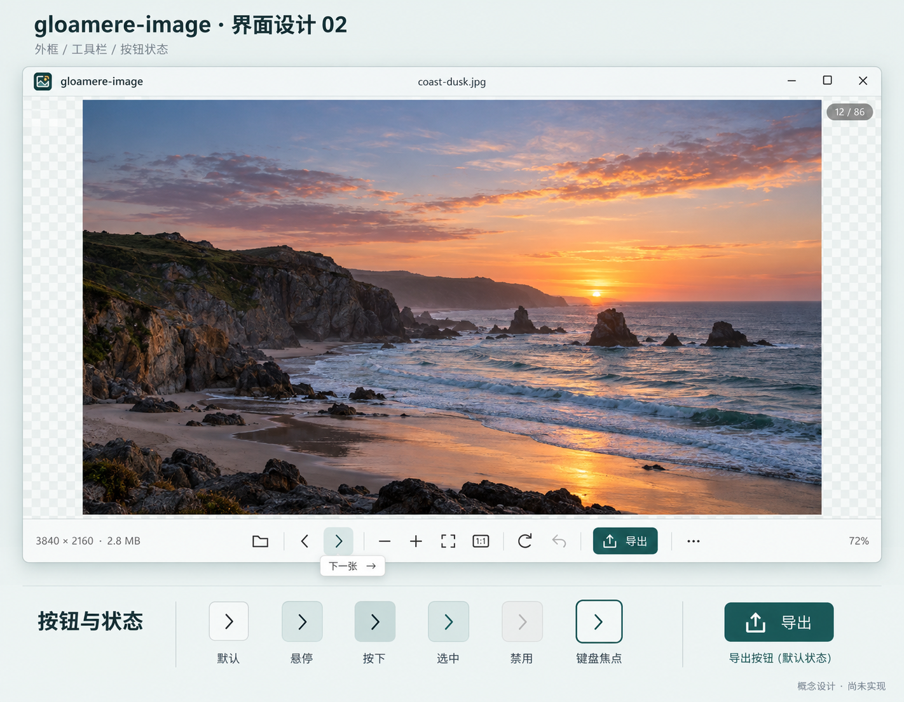

# 外框、工具栏与按钮设计 02

2026-10-19。使用内置 imagegen 生成的视觉提案，尚未接入程序；不是已实现界面的截图。



## 设计取舍

- 保留大画布和单行底栏，默认不常驻侧栏或缩略图带。
- 外框、标题栏和底栏统一为偏冷的白色；使用现有品牌的深青、灰绿与少量琥珀色。
- 常规按钮为 34 × 34 逻辑点，图标 18–20 点；按打开、切图、缩放、编辑、导出分组。
- 普通按钮保持轻量；导出使用深青色文字按钮，低频动作仍进入更多菜单。
- 状态覆盖默认、悬停、按下、选中、禁用和键盘焦点。图中的箭头仅用于对比状态；实际实现时，前后切图属于瞬时操作，不保留“选中”，该状态用于列表开关等可切换动作。
- 配色：背景 `#E8EFEE`，外框 `#FAFCFB`，分隔线 `#D7E1DE`，正文 `#263C3C`，深青 `#184B4B`，灰绿 `#5C9290`，琥珀 `#E6B55A`。

## 后续实施边界

图稿用于评审视觉方向。Windows 拖拽、缩放、最大化、贴靠、系统菜单、DPI、键盘焦点和辅助功能须保留原生行为。不能直接用一张生成图片替代运行时控件；图标继续使用可缩放的代码绘制。

窄窗口仍按现有工具栏策略收起低频动作；图稿不是 800 逻辑点下全部控件同时可见的几何验收。文字提示和错误说明保留，图片颜色、透明度、复制与导出像素不受外框配色影响。

## 生成记录

- 工具：内置 `imagegen`。
- 参考图 1：本轮 0.7.0 实际渲染的画布与工具栏，仅作为功能布局参考。
- 参考图 2：`assets/gloamere-image-256.png`，保持现有品牌身份。
- 输出：`ui-shell-buttons-02.png`。海岸照片为图稿中的示例内容。

最终提示词：

```text
Use case: ui-mockup. Asset type: a high-fidelity visual concept board for a real Windows desktop local image viewer named exactly 'gloamere-image'. This is a design preview, not a screenshot of implemented software. Input image 1 is the existing application canvas and toolbar, only a functional/layout reference. Input image 2 is the existing brand icon, preserve this exact brand identity, do not redesign the logo.
Primary request: redesign the outer window chrome AND the entire button system in one coherent restrained professional direction. Create one sharp front-on 2D UI design board, landscape around 1800x1400, with a large complete application window occupying the upper 78%, and a compact button-state detail strip below. The viewer's main job is looking through local visual assets quickly, preserving maximum image area. Use the brand's deep teal, muted jade and small amber accent with a cool white / pale green-gray shell. No marketing website layout.
Window: a very thin subtle border, modest 8px corner radius and soft realistic Windows shadow, precise 40px titlebar with existing small logo and 'gloamere-image' at left, 'coast-dusk.jpg' in the titlebar center, conventional Windows minimize, maximize, close controls at right. No macOS traffic lights. Canvas dominates, with quiet fine checkerboard transparency margins and an attractive realistic coastal landscape at dusk as the sample image, correctly centered with margins. Small unobtrusive '12 / 86' index in the top right of canvas. Main default has no sidebar, no permanent filmstrip, no redundant top ribbon.
Bottom toolbar: 56px high, cool white with hairline top divider, three zones: left compact metadata '3840 × 2160 · 2.8 MB'; center a carefully spaced single row of readable thin-line icons grouped by function: open folder; previous and next image; zoom out, zoom in, fit, '1:1'; rotate clockwise, undo; a modest filled deep-teal Export button labeled exactly '导出' with an export icon; then a quiet three-dot More button. Right shows zoom '72%'. Keep exactly one instance of each control. Default icon hit targets are 34x34 logical px, glyphs 18-20px, consistent 1.7px rounded strokes, compact 8px radius, group separator rules instead of lots of capsules. All controls align precisely on the same baseline. Design for one-hand frequent browsing, keep image navigation visibly grouped. Main toolbar should appear light, quiet and refined. Use restrained teal only for active/focus and the one export action. Do not fill all buttons. Show a tasteful tiny tooltip '下一张  →' under the Next control if it can fit without clutter.
Detail strip below the main window, separated by whitespace: a short heading '按钮与状态', show 6 enlarged sample icon-button states horizontally labelled exactly '默认', '悬停', '按下', '选中', '禁用', '键盘焦点'. The samples demonstrate: default gray icon no fill; hover pale jade fill; pressed slightly darker inset pale teal; selected teal icon and subtle teal fill; disabled low contrast gray; keyboard focus visible 2px teal outline. Add a small secondary export-button sample at far right. Font for UI is Windows-style Segoe UI with Microsoft YaHei Chinese, crisp and practical. Board title at top outside window: 'gloamere-image · 界面设计 02', small subline '外框 / 工具栏 / 按钮状态'. Footer outside app: '概念设计 · 尚未实现'.
Palette: background #E8EFEE, shell #FAFCFB, dividers #D7E1DE, text #263C3C, deep teal #184B4B, muted jade #5C9290, tiny amber #E6B55A. Avoid purple gradients, neon, thick black outlines, excessive gloss or glass blur, decorative charts, fake feature panels, overlarge corner radii, oversized navigation bars, heavy branding, fictitious AI-certification labels, and no extra unrequested features. Composition must clearly show the whole outer frame and every bottom button. Extremely crisp professional desktop product design, legible text and carefully aligned icons.
```
