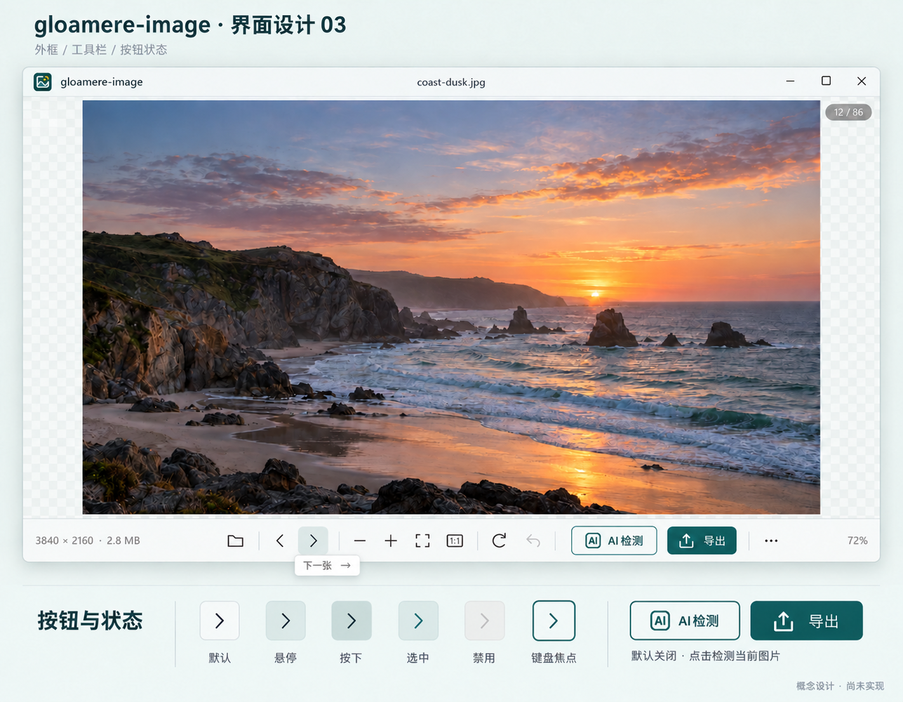

# 外框、按钮与手动 AI 入口设计 03

2026-10-19。内置 imagegen 视觉提案，替代 02 作为当前评审稿。外框与完整按钮视觉尚未实施；单独 AI 入口和手动策略另见 [行为设计](../manual-ai-detection.md)。



## 本次变化

- 沿用现有品牌与 02 的轻量外框、大画布、单行工具栏及六种按钮状态。
- 增加独立的次级“AI 检测”按钮。默认不检测，仅点击时检查当前图片；导出继续作为主要视觉动作。
- 示例照片未经检测，不放任何 AI 判断角标。图中低部“默认关闭”是设计注释，不是画布上的常驻提示。
- 操作按钮不保留选中状态；选中样式仅适用于真实开关。Windows 原生窗口行为、窄窗布局、焦点与辅助功能边界沿用 [02 的说明](ui-shell-buttons-02.md)。

## 生成记录

工具：内置 imagegen。第一步以 `ui-shell-buttons-02.png` 为编辑对象，第二步仅恢复右下角概念设计说明。保留生成原件，最终选定文件复制到本目录。

第一次编辑提示词：

```text
Use case: ui-mockup, precise revision of the provided high-fidelity design board. Edit target: the attached gloamere-image '界面设计 02' board. Preserve its existing coast sunset photo, brand icon, window structure, light teal-white palette, typography, border, titlebar and professional restrained button system. Change only the following to reflect the user's new instruction: AI image detection is OFF by default and runs on the CURRENT picture only after the user clicks one separate explicit button.
1. In the main bottom toolbar, add one permanently visible secondary button labelled exactly 'AI 检测', with a simple rounded 'AI' glyph icon. Place it immediately before the filled teal '导出' button. AI detection is a secondary action, use a pale neutral/white background and thin teal outline with teal text. Keep Export filled deep teal as before. Keep all existing open/previous/next/zoom/fit/1:1/rotate/undo/More controls once each, precise spacing, exactly one single-row toolbar. Adjust central group spacing and available side metadata whitespace to fit comfortably; do not add a second toolbar or sidebar.
2. In the button-state detail area below the window, preserve all six states and their labels. Add a small secondary 'AI 检测' button sample next to the export sample, and the short explanation '默认关闭 · 点击检测当前图片'. Keep this text outside the application viewport as design annotation. Do not put an 'AI off' warning on the canvas. Do not add model scores or any detection badges to the sample photo, since it has not been detected.
3. Change the board title to 'gloamere-image · 界面设计 03', retain the subtitle '外框 / 工具栏 / 按钮状态', retain footer '概念设计 · 尚未实现'.
Everything else stays consistent with the existing design. Crisp readable Chinese text, thin-line icons, conventional Windows minimize/maximize/close controls, image area still dominates. This is a conceptual visual design, no invented AI accuracy/realness claims, no automatic-detection toggle anywhere.
```

最终定向修正提示词：

```text
Edit only one small detail of this existing gloamere-image 界面设计 03 board: restore a small, clearly readable gray footer caption at the bottom-right corner, inside the canvas margin, reading exactly '概念设计 · 尚未实现'. Preserve every other pixel as closely as possible: the existing title 03, photo, app window, all toolbar icons, AI 检测 and 导出 buttons, six button states and their Chinese labels, default-off annotation. Do not crop, rescale or rearrange the board. The single change is the missing footer notice.
```
