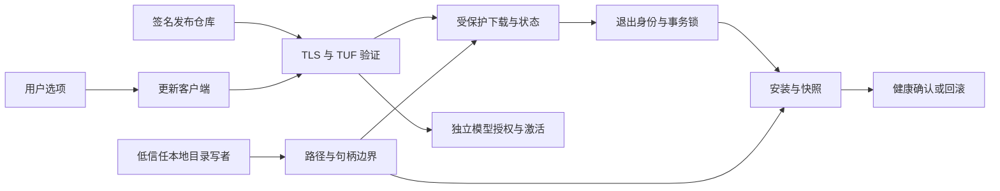

# 完整在线更新：受保护对象、原生边界与恢复设计

日期：2026-10-12 UTC。实施起点：本地 dev 52112232c96fbcbb0469541114ee2acf6dc48d21。
本文是本轮实施设计及决策记录，未宣称上线完成；不覆盖输入 v0.2 文档。
用户已确认完整在线更新、Windows 优先、默认本地图像处理、应用/模型授权分离。
本轮不改变真实 v0.6 安装、用户目录 ACL、注册信息、机器重启状态或生产信任。

## 使用流程与交付边界

用户正常查看素材时，更新检查不能阻塞图像浏览。启用应用自动更新后，客户端在
允许的网络、电源及空闲条件下检查签名元数据；手动检查和一次下载授权继续保留。
验证、下载和恢复提示可见；只有正常退出且进程身份确认后才能安装。首次启动
通过健康检查才提交，失败恢复上一已知健康版本。模型更新要求单独授权，不能
由应用更新选项、远端模型字段或下载成功自动获得执行权。

本轮保留并增强现有链路，不交付删除更新的兼容分支，不引入并行第三套安装链。
生产 root、TLS 服务及签名发布仓库未配置时，ProductionConfig::bundled() 必须
继续返回 NotConfigured。测试成功、完成集成和生产上线是三个不同结论。

## 实际工程和已有控制

Rust/egui 客户端由 src/updater/client.rs 的选项与 Job 驱动；engine.rs 管理
受授权目标、取消、下载完成及退出后的 helper。crates/update-security 执行
签名 root/role、目标绑定、版本与过期防回滚。installer_native.rs 的 Transaction
以 active/journal、原文件快照和 integration::Snapshot 实现安装与健康回滚。
installer/recovery.iss 负责 Inno 入口的锁和原生 helper 调用；private_paths.rs、
platform.rs、windows.rs、storage.rs 负责命名空间、安全创建、持久化和锁。

前次实际 Win10 矩阵证明：0x2 与 0x100 都可在空目录设置 mount-point reparse；
share3 的 LIST_DIRECTORY pin 不阻止；share1 只阻止0x2，不阻止0x100/0x110。
既有非空目录测试拒绝145只是一项观察，不能推导所有 tag/filter 都安全。
现有 Windows 单元测试中的 cfg(test) 平台/集成适配器不能当成完整原生生命周期。

## 受保护对象

|对象|完整性与可用性目标|证据入口|
|---|---|---|
|编译内置生产 root、角色/产品/平台/通道 pin|远端或 CLI 不能替换本地信任根|update-security；ProductionConfig::bundled|
|TUF 版本 floor、隔离失败版本、授权 receipt|重启、恢复及并发后不能接受旧目标|engine::open_trust；update-security|
|安装根、state 根、下载根及其父子绑定|验证的对象必须是操作的对象|private_paths::walk；windows.rs|
|包、恢复 helper、launcher stamp 和 launcher|验证后不可被替换/改写并执行|NativePinReadFile；engine::run_helper|
|active、journal、preimages、集成快照、健康 ticket|只能恢复所绑定安装根和事务|installer_native::active；Transaction|
|用户原图、偏好、独立模型组件|更新不能删除原图或扩大模型授权|client::Authorization；model updater|

## 攻击者与非能力

远端攻击者可控制返回字节、未授权仓库、网络中断、重定向及旧签名目标重放；
不能凭 HTTPS 地址获得发布签名权。受污染下载和本地目录项始终是未信任输入。
本地低信任主体可能有祖先上的 ADD_FILE/ADD_SUBDIRECTORY、WRITE_EA、
WRITE_ATTRIBUTES 或 DELETE 等不同组合；必须按具体有效 ACE 与开放句柄验证。
真实 profile 的未知 SID0x110 和 D:临时根0x10110 是两项独立拒绝原因。
不假定未知 SID 已废弃；不为使测试通过授予其信任。

管理员、SYSTEM、内核或完全控制当前 TokenUser/可执行文件的主体不属于本轮
可抵抗边界；但测试也不调整其权限或安全策略。现有测试的限制访问句柄不是
另一个恶意用户的 impersonation。多主体/跨进程竞争和 filter 行为需要单独证据。
生产服务器运营、凭据、root 发布和密钥生命周期尚未授权，不作假设性部署。

## 安装与恢复不变量

1. 默认无信任配置时零自动请求和零安装；合法授权后只使用不降级的 TLS。
2. 下载目标始终绑定 TUF 签名 identity、长度、哈希、通道和 authorization。
   安装前重新验证，不信任可修改的 UI 字符串或普通 JSON 自称已验证。
3. 每个绝对路径前缀在使用前按句柄检查目录/非 reparse/身份/ACL；保留 pin
   到最后一次路径操作结束。掉进程后重新建立和验证，不能继承“上次已安全”。
4. CREATE_NEW/独占目录创建使用显式 TokenUser owner 和 protected DACL，
   冲突只复核既有对象，绝不重置 owner/DACL。拒绝必须先于快照或 active 发布。
5. 安装前锁定维护和会话，等待精确退出身份；不截断非空/多链接锁。
6. active 与 journal 的安装根、事务、产品绑定一致；先持久化写入意图/备份，
   后改 payload/集成，再持久化阶段。未知 journal 或改变的快照要求人工恢复。
7. 健康未提交不能删除 preimages；恢复只针对哈希和 owned inventory 认可的
   产品对象，不递归删除用户目录。崩溃、取消、磁盘满保留可判定状态。
8. 应用与模型的版本 floor、同意、目标验证、自测及激活状态独立。

## 架构比较与本轮决定

|方案|收益|当前未证明/迁移成本|本轮决定|
|---|---|---|---|
|Velopack Rust SDK|成熟打包、下载及跨平台更新入口|官方 API 的重启应用包行为不能直接证明本项目 TUF、健康事务或低信任祖先安全；需打包/安装布局迁移|保留评估，不立即替换链路|
|WinSparkle C ABI|成熟 appcast UI、Ed25519 包签名，可用于 egui 应用|仍需安装器；不能替代 TUF root 轮换/floor 或本项目 journal/模型授权|不新增第二下载/安装责任方|
|现有 TUF+Inno，增强 pin|最快修复已证实0x2，保留所有恢复行为|仍按路径操作；0x100/0x110 不得豁免；实际旧安装不因此合格|立即实施有界修复并原生回归|
|固定目录句柄与相对 NT 操作|RootDirectory 可减少重新解析祖先；创建/读取/发布可绑定实际目录对象|需要统一相对 open/rename、显式 descriptor、pin 生命周期、执行/加载和 Inno 外部进程入口；绝非仅换一次 OpenOptions|作为下一决策候选，设计/原生证据先行|
|OS 管理命名空间，如 MSIX|由操作系统承担部分部署/完整性责任|证书/身份、旧 Inno 迁移、用户权限、模型写路径和分发条件需验证；当前未授权|不自行迁移真实安装|

直接换库不能消除路径信任问题。相对句柄也不自动保护按路径启动的 EXE、DLL
加载或旧快捷方式，必须覆盖从验证到执行的整条边。目录非空只作测试变量，
不作为泛化的 WRITE_ATTRIBUTES 例外。此决定接受父线程最新架构边界。

## 首个实现：保留策略，强化目录 pin

private_paths::Identity::pin 将目录 sharing 改成 FILE_SHARE_READ。
PinNativeAncestors 及 EnsureNativeProductDirectory 的目录 CreateFileW 同步
改 share1；叶锁 sharing3 保留，因为并发 LockFile 语义不同，不混用目录规则。
保留 FILE_LIST_DIRECTORY、READ_CONTROL、READ_ATTRIBUTES、no-follow 和
现有 foreign WRITE_ATTRIBUTES/EA/DELETE/DACL/owner mask。0x2/0x4 的
create exception 只可结合实际 read-only lifetime pin 讨论，不能再称无条件安全。
若新写句柄或预开写句柄妨碍取得 pin，返回明确安全拒绝，不重试绕过 sharing。

修复不解决真实 profile0x110、D:10110、既有产品所有者或超大 reboot 值。
完整本机升级是否需要权限/部署变更必须在具体安全设计和最小作用域确认后
单独授权；本轮不自行选择新真实安装位置或静默扩大 ACL 修复。

## 私有原生生命周期验证接口

沿用同一 Transaction 状态机，不能另写模拟更新器来宣称完整链路。首先扩展
非发布 Rust/Inno 夹具到实际新建 protected 根、missing-component、锁、临时
文件、atomic publication 和 pin 竞争；分别标注 real Win32 与 synthetic adapter。
随后设计受限 Host/Integration 接口，把 KnownFolder、重启状态及 registry
副作用从交易算法分离；生产构造固定 OS 路径，夹具构造只接受新建测试树。
私有文件系统阶段可复用实际 production storage，registry fixture 采用独立数据
存储不改真实注册信息；其结果不能冒充实际 Windows registry/快捷方式验收。
没有生产 CLI/env 信任开关，没有模型自动授权，没有复用全局安装器的捷径。
接口变更须另写实施文档后编码，接受云端独立评估，避免未经验证的新安装链。

## 稳定 launcher 与更新协议自身的升级边界

当前普通更新有意保持唯一 launcher，InstallPlan.launcher_protocol、布局中的
launcher identity 及启动恢复入口受到绑定。这是当前事务恢复的约束，不表示
launcher 或 updater 协议已经永久解决升级。完整组件覆盖必须另包含经过认证、
可恢复的 bootstrap/launcher 迁移；不能用普通 runtime 更新偷偷替换唯一入口。

首版边界：普通在线目标只允许与当前 launcher 协议兼容的 runtime/worker；
新 runtime 必须在 manifest 中声明可支持的 launcher/journal 协议范围，安装前
验证交集。超出协议能力的目标应明确提示需要受认证的人工 bootstrap，不能
先覆盖 launcher 再期待其读懂新 journal。首次引导也使用独立的已验证安装包。
此时应明确“普通组件在线更新已覆盖，launcher 特殊迁移尚需人工引导”。

后续 bootstrap 迁移设计必须：由 TUF 已编译授权的独立目标类别绑定新 launcher
及恢复 helper 的完整 identity、协议版本/兼容范围和版本 floor；先取得旧维护
及会话锁，证明旧新双方可读取迁移 journal；先持久化旧 launcher/preimages
和独立恢复入口并验证其 owner/DACL/hash、可启动能力，才发布切换意图。
切换使用同卷的有界原子发布，健康票据绑定新 launcher/协议/事务 identity；
健康确认前保留旧入口，崩溃时独立恢复入口只能按已验证 migration journal
恢复。旧协议不支持迁移类别/序列时拒绝自动处理，交给人工 bootstrap。

独立恢复入口不是另一个常驻更新链，也不能靠未验证 PATH 搜索、临时目录 EXE
或下载成功来信任。现有源码尚无自动 launcher 迁移的完整实现/Windows 验收，
本轮不为赶工覆盖真实唯一恢复入口。该接口需独立设计、测试与决策后实现。

## 本轮验收与未验证项

实际 Win10 构建；Rust/Inno pin 一致；0x2/0x4/0x6 新开与预开写句柄拒绝；
受保护子目录创建正常；0x100/0x110 foreign ACE 在操作前拒绝且对象不改；
普通和 EX reparse 负例；重新打开已 redirected 对象拒绝；raw SD/identity 快照。
然后真实 storage 创建/冲突/取消/持久化与原生 ABI 回归、fmt/严格 Clippy。
旧 ambient namespace 失败保留或明确改成“host policy 拒绝”测试，不能删成无测。
完整私有事务、标准 token、Win11、多进程崩溃竞争、真实注册/快捷方式、实际
TLS 服务器、生产 root 和新的 Setup 仍分别列为未跑/未配置，不能统称已完成。

## 官方资料

- TUF: https://theupdateframework.github.io/specification/latest/
- Velopack Rust: https://docs.velopack.io/getting-started/rust
- Velopack FAQ: https://docs.velopack.io/troubleshooting/faq
- WinSparkle: https://github.com/vslavik/winsparkle
- NtCreateFile RootDirectory/security descriptor:
  https://learn.microsoft.com/en-us/windows/win32/api/winternl/nf-winternl-ntcreatefile
- Share and access: https://learn.microsoft.com/en-us/windows/win32/api/fileapi/nf-fileapi-createfilew
- Reparse0x2/0x100 ordinary generic rules:
  https://learn.microsoft.com/en-us/openspecs/windows_protocols/ms-fsa/4aeefef8-92c3-4abc-af7a-a610caf8a165
